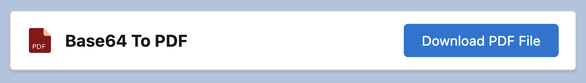

# Base64 To PDF

A simple utility for Base64 encoded strings to decode and download them as PDF file.

**Type:** Building Block

**Available in:** App Page · Home Page · Record Page · Flow Screen



## Read on Medium

<a href="https://javascript.plainenglish.io/how-to-display-and-download-base64-encoded-pdf-documents-with-lightning-web-components-d4a10c7fa4c3">
  
</a>

**[How to display and download Base64 encoded PDF documents with Lightning Web Components](https://javascript.plainenglish.io/how-to-display-and-download-base64-encoded-pdf-documents-with-lightning-web-components-d4a10c7fa4c3)**

## Attributes

| Name      | Type   | Default       | Description                                                                                                                 |
| --------- | ------ | ------------- | --------------------------------------------------------------------------------------------------------------------------- |
| base64    | string |               | The content of the PDF file as Base64 encoded string, without a data URL prefix. An example file is used until this is set. |
| file-name | string | 'example.pdf' | The name of the downloaded file.                                                                                            |

## Usage

```html
<c-base64-to-pdf base64={pdfContent} file-name="invoice.pdf"></c-base64-to-pdf>
```

The content is offered as a PDF download. Without the `base64` attribute, the component offers an example file (see `example.js`). If `base64` is set but empty, for example while your data is loading, it offers no download at all.
