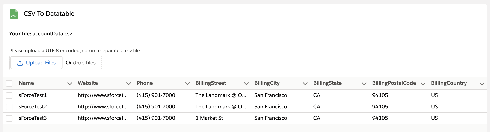

# CSV Importer

Imports CSV files into Salesforce in steps: the file is read and previewed, its columns are mapped to the fields of an object, the rows are checked against these fields, and then inserted or upserted.

**Type:** Component

**Available in:** App Page · Home Page · Record Page · Flow Screen



## Read on Medium

<a href="https://javascript.plainenglish.io/how-to-build-a-simple-csv-parser-with-lightning-web-components-464a110a1cd2">
  
</a>

**[How to Build a Simple CSV Parser with Lightning Web Components](https://javascript.plainenglish.io/how-to-build-a-simple-csv-parser-with-lightning-web-components-464a110a1cd2)**

## Attributes

| Name                       | Type     | Default | Description                                                                                                                                                                                          |
| -------------------------- | -------- | ------- | ---------------------------------------------------------------------------------------------------------------------------------------------------------------------------------------------------- |
| external-id-field-api-name | string   | ''      | The field the rows are upserted by, e.g. an external ID field or Id: rows with the value of an existing record update it, the others create new records. Without it, every row creates a new record. |
| import-object-api-name     | string   | ''      | The object the rows are imported into, e.g. 'Contact'. Without it, users enter the object in the wizard.                                                                                             |
| max-file-size-mb           | number   | 5       | The largest file in megabytes that can be read.                                                                                                                                                      |
| max-rows                   | number   | 10000   | The most rows a file may have, not counting the header.                                                                                                                                              |
| success-count              | number   | 0       | Read-only. The number of rows that created or updated a record in the last import. Also available as a Flow output.                                                                                  |
| failed-count               | number   | 0       | Read-only. The number of rows that failed in the last import. Also available as a Flow output.                                                                                                       |
| created-record-ids         | string[] | []      | Read-only. The ids of the records the last import created. Also available as a Flow output.                                                                                                          |

## Events

| Name     | Detail                                                                                                                                                            | Description                                                                         |
| -------- | ----------------------------------------------------------------------------------------------------------------------------------------------------------------- | ----------------------------------------------------------------------------------- |
| imported | `objectApiName`; `created`, `updated` and `failed`: the number of rows; `recordIds`: the ids of the saved records; `createdRecordIds`: the ids of the new records | Fired when the import is done.                                                      |
| parsed   | A copy of the result: `fileName`, `headers`, `keyField`, `rows` and `delimiter`                                                                                   | Fired when a file was parsed. `keyField` names the property holding each row's key. |

## Usage

```html
<c-csv-importer
  import-object-api-name="Contact"
  external-id-field-api-name="Email"
  max-file-size-mb="10"
  onimported={handleImported}
></c-csv-importer>
```

### Upload

Drop a `.csv` file on the upload area or select it. The importer shows the first 20 rows and how many rows the file has.

- The delimiter is detected from the first line: comma, semicolon or tab, whichever occurs most often outside quoted fields. It can also be chosen by hand.
- The encoding is UTF-8 by default; choose Windows-1252 for files exported by older versions of Excel. Changing the delimiter or the encoding reads the file again.
- Files larger than max-file-size-mb or with more rows than max-rows are rejected with a message.

Files are parsed according to [RFC 4180](https://www.rfc-editor.org/rfc/rfc4180) by the shared `c/csvParser` module:

- Quoted fields may contain delimiters, line breaks and doubled quotes (`""`).
- Empty lines are ignored, including a trailing one.
- Rows with fewer columns than the header are filled with empty values, and values beyond the last header column are dropped.
- Empty and duplicate column names get a unique name, such as `Column 2` or `Name (2)`.

If a file cannot be read or is not valid CSV, for example because a quote is never closed, the importer clears the preview and shows an error message.

### Map fields

The next step maps every column to a field of the object set in import-object-api-name, or of the object users enter by its API name. It isn't called object-api-name, because record pages set that property to the object of the page.

- Columns are matched automatically when they equal a field's label or API name, ignoring case, spaces and punctuation: `First Name`, `first_name` and `FirstName` all match `FirstName`.
- Only fields records can be created with are offered. Columns without a field are skipped, and a field can't be chosen for two columns.
- Every required field needs a column, unless Salesforce fills it in on its own, such as the owner or a checkbox. With external-id-field-api-name, that field needs a column as well.
- **Download mapping** saves the mapping as JSON to use it again; **Upload a mapping** applies a saved one, skipping fields the object doesn't have:

```json
{
  "version": 1,
  "objectApiName": "Contact",
  "mapping": { "First Name": "FirstName", "E-Mail": "Email", "Notes": "" }
}
```

Going back to the upload keeps the mapping; a new file keeps the fields of the columns it still has.

### Review

The last step checks every row against the mapped fields before anything is written:

| Field type                         | Valid values                                                                     |
| ---------------------------------- | -------------------------------------------------------------------------------- |
| Required                           | Any value that isn't empty                                                       |
| Number, Currency, Percent          | Digits with a dot for decimals, e.g. `1234.5`                                    |
| Whole number                       | Digits without decimals                                                          |
| Date                               | `YYYY-MM-DD`, e.g. `2026-11-07`                                                  |
| Date/Time                          | ISO 8601, e.g. `2026-11-07T10:30:00Z`                                            |
| Checkbox                           | `true`, `false`, `yes`, `no`, `1` or `0`, ignoring case                          |
| Email                              | An address with one `@` and a domain such as `example.com`                       |
| Picklist and multi-select picklist | The API names of the values of the default record type; several separated by `;` |

Rows with errors are marked, and the cells with errors are highlighted; the error icon of a row lists its messages. The table shows 50 rows at a time and loads more when users scroll down. Values can be corrected in the table and are checked again on save. **Only rows with errors** hides the valid rows and adds a column with each row's number in the file. Corrections are kept when the mapping changes and dropped for a new file.

The rows can be imported once none of them has an error.

### Import

**Import** sends the rows to the `CsvImportController` Apex class in chunks of 200, one after the other, and a progress bar shows how far it got:

- Without external-id-field-api-name, every row creates a new record. With it, the rows are upserted: a row with the value of an existing record updates it, the others create new records. The field has to identify records, such as an external ID field, Id, or a standard field like the email of a contact.
- Values are converted to the types of the fields. Empty cells leave a field unset, so an upsert doesn't clear values of existing records. Date/times without a time zone are taken as the time of the browser.
- The controller runs `with sharing` and in user mode, so the sharing rules, object and field permissions of the running user apply. A row that fails doesn't stop the others.
- Lookups are not resolved by name: a lookup column needs record ids.

At the end, the importer shows how many records were created and updated, and lists the failed rows with the reason. **Download failed rows** saves them as a CSV file with the delimiter of the uploaded file and an additional `Import Error` column, so they can be fixed and imported again. Going back is no longer possible once the import started, so the rows can't be imported twice by accident. **New import** starts over with the upload and keeps the chosen encoding and delimiter.

### Flow screens

In a Flow screen, the attributes are inputs of the component, and the result of the import is passed on as outputs: **Successful Rows** (`successCount`, created or updated), **Failed Rows** (`failedCount`) and **Created Record Ids** (`createdRecordIds`), for example to show a summary on the next screen or to loop over the new records. **New import** sets the outputs back to 0 and an empty list.

### Demo data

[`data/csv-importer/contacts.csv`](https://github.com/svierk/awesome-lwc-collection/blob/main/data/csv-importer/contacts.csv) has 50 contacts to try the importer with the object `Contact`. Its columns match the fields automatically, and three rows have errors on purpose: row 12 an invalid email, row 27 a date that isn't in `YYYY-MM-DD`, and row 42 no last name. Correct them in the review to import all 50 contacts.

## Custom Labels

The texts users see are Custom Labels, so they can be translated in Setup with the Translation Workbench. Copy them together with the component.

| Name                                 | Value                                                                                               |
| ------------------------------------ | --------------------------------------------------------------------------------------------------- |
| CsvImporter_Back                     | Back                                                                                                |
| CsvImporter_Comma                    | Comma (,)                                                                                           |
| CsvImporter_CommaName                | comma                                                                                               |
| CsvImporter_CsvFile                  | CSV file                                                                                            |
| CsvImporter_Delimiter                | Delimiter                                                                                           |
| CsvImporter_DetectAutomatically      | Detect automatically                                                                                |
| CsvImporter_Encoding                 | Encoding                                                                                            |
| CsvImporter_FileNotRead              | The file could not be read: {0}                                                                     |
| CsvImporter_FileTooLarge             | The file is larger than {0} MB.                                                                     |
| CsvImporter_NewImport                | New import                                                                                          |
| CsvImporter_Next                     | Next                                                                                                |
| CsvImporter_Semicolon                | Semicolon (;)                                                                                       |
| CsvImporter_SemicolonName            | semicolon                                                                                           |
| CsvImporter_StepImport               | Import                                                                                              |
| CsvImporter_StepMapFields            | Map Fields                                                                                          |
| CsvImporter_StepReview               | Review                                                                                              |
| CsvImporter_StepUpload               | Upload                                                                                              |
| CsvImporter_Summary                  | {0}: showing {1} of {2} rows, separated by {3}.                                                     |
| CsvImporter_Tab                      | Tab                                                                                                 |
| CsvImporter_TabName                  | tab                                                                                                 |
| CsvImporter_Title                    | CSV Importer                                                                                        |
| CsvImporter_TooManyRows              | The file has more than {0} rows.                                                                    |
| CsvImporterImport_Done               | Done: {0} created, {1} updated, {2} failed.                                                         |
| CsvImporterImport_DownloadFailedRows | Download failed rows                                                                                |
| CsvImporterImport_Error              | Error                                                                                               |
| CsvImporterImport_ErrorColumn        | Import Error                                                                                        |
| CsvImporterImport_Import             | Import                                                                                              |
| CsvImporterImport_Insert             | Every row creates a new record.                                                                     |
| CsvImporterImport_Progress           | Processed {0} of {1} rows.                                                                          |
| CsvImporterImport_Ready              | {0} rows are ready to be imported into {1}. {2}                                                     |
| CsvImporterImport_Row                | Row                                                                                                 |
| CsvImporterImport_Upsert             | Rows with the {0} of an existing record update it, the others create new records.                   |
| CsvImporterMapping_Column            | Column                                                                                              |
| CsvImporterMapping_DontImport        | Don't import                                                                                        |
| CsvImporterMapping_DownloadMapping   | Download mapping                                                                                    |
| CsvImporterMapping_Duplicates        | More than one column is mapped to: {0}.                                                             |
| CsvImporterMapping_Example           | Example                                                                                             |
| CsvImporterMapping_FieldFor          | Field for {0}                                                                                       |
| CsvImporterMapping_ImportingInto     | Importing into {0}.                                                                                 |
| CsvImporterMapping_MappingError      | The mapping could not be used: {0}                                                                  |
| CsvImporterMapping_MissingFields     | Map a column to every required field: {0}.                                                          |
| CsvImporterMapping_NoMapping         | it has no mapping                                                                                   |
| CsvImporterMapping_Object            | Object                                                                                              |
| CsvImporterMapping_ObjectApiName     | Object API Name                                                                                     |
| CsvImporterMapping_ObjectError       | The object {0} can't be used: {1}                                                                   |
| CsvImporterMapping_ObjectHelp        | The API name of the object to import into, e.g. Contact or Invoice__c.                              |
| CsvImporterMapping_ObjectPlaceholder | e.g. Contact                                                                                        |
| CsvImporterMapping_OtherObject       | it is for {0}, not for {1}                                                                          |
| CsvImporterMapping_SalesforceField   | Salesforce field                                                                                    |
| CsvImporterMapping_UploadMapping     | Upload a mapping                                                                                    |
| CsvImporterReview_Errors             | Rows with errors: {0} of {1} ({2}). Correct them in the table, or fix the file and upload it again. |
| CsvImporterReview_NoErrors           | Rows with errors: {0} of {1}.                                                                       |
| CsvImporterReview_OnlyErrors         | Only rows with errors                                                                               |
| CsvImporterReview_PicklistError      | The picklist values could not be loaded, so they aren't checked: {0}                                |
| CsvImporterReview_Row                | Row                                                                                                 |
| CsvParser_Column                     | Column {0}                                                                                          |
| CsvParser_UnclosedQuote              | Invalid CSV: the quoted field starting on line {0} is never closed.                                 |
| CsvValidator_NotBoolean              | {0}: "{1}" isn't true or false.                                                                     |
| CsvValidator_NotDate                 | {0}: "{1}" isn't a date. Use YYYY-MM-DD.                                                            |
| CsvValidator_NotDateTime             | {0}: "{1}" isn't a date and time. Use YYYY-MM-DDThh:mm:ssZ.                                         |
| CsvValidator_NotEmail                | {0}: "{1}" isn't an email address.                                                                  |
| CsvValidator_NotInPicklist           | {0}: "{1}" isn't a value of the picklist.                                                           |
| CsvValidator_NotNumber               | {0}: "{1}" isn't a number. Use a dot for decimals, e.g. 1234.5.                                     |
| CsvValidator_NotWholeNumber          | {0}: "{1}" isn't a whole number.                                                                    |
| CsvValidator_Required                | {0} is required.                                                                                    |
| CsvValidator_RowError                | This row has an error.                                                                              |
| CsvValidator_RowErrors               | This row has {0} errors.                                                                            |
| ErrorAlert_Error                     | Error                                                                                               |
| ErrorUtils_UnknownError              | Unknown error                                                                                       |

## Component Dependencies

| Name                    | Type | Description                                                                             |
| ----------------------- | ---- | --------------------------------------------------------------------------------------- |
| CsvImportController     | Apex | Inserts or upserts the rows in user mode and returns the result of each row.            |
| CsvImportControllerTest | Apex | Test class for CsvImportController.                                                     |
| csvImporterImport       | LWC  | Imports the checked rows in chunks and shows the result of each row.                    |
| csvImporterMapping      | LWC  | Maps the columns of a CSV file to the fields of a Salesforce object.                    |
| csvImporterReview       | LWC  | Checks the rows of a CSV file against the mapped fields and lets users correct them.    |
| csvParser               | LWC  | Shared module that parses comma, semicolon or tab separated text according to RFC 4180. |
| csvValidator            | LWC  | Shared checks for CSV values against the fields of a Salesforce object.                 |
| errorAlert              | LWC  | Inline alert that shows error messages to the user.                                     |
| errorUtils              | LWC  | Shared functions to read error messages and show error toasts.                          |
| labelUtils              | LWC  | Shared function to fill the placeholders of Custom Labels.                              |
