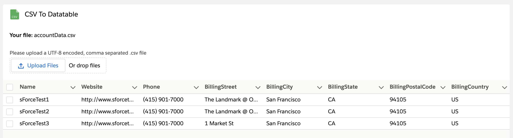

# CSV To Datatable

A simple parser for UTF-8 encoded, comma separated .csv files.

**Available in:** App Page · Home Page · Record Page



## Read on Medium

<a href="https://javascript.plainenglish.io/how-to-build-a-simple-csv-parser-with-lightning-web-components-464a110a1cd2">
  
</a>

**[How to Build a Simple CSV Parser with Lightning Web Components](https://javascript.plainenglish.io/how-to-build-a-simple-csv-parser-with-lightning-web-components-464a110a1cd2)**

## Usage

```html
<c-csv-to-datatable></c-csv-to-datatable>
```

The component is self-contained: after uploading a UTF-8 encoded, comma separated `.csv` file, the parsed rows are displayed in a datatable.

Files are parsed according to [RFC 4180](https://www.rfc-editor.org/rfc/rfc4180) by the shared `c/csvParser` module:

- Quoted fields may contain commas, line breaks and doubled quotes (`""`).
- Empty lines are ignored, including a trailing one.
- Rows with fewer columns than the header are filled with empty values, and values beyond the last header column are dropped.
- Empty and duplicate column names get a unique name, such as `Column 2` or `Name (2)`.

If a file cannot be read or is not valid CSV, for example because a quote is never closed, the component clears the table and shows an error message.

## Component Dependencies

| Name       | Type | Description                                                           |
| ---------- | ---- | --------------------------------------------------------------------- |
| csvParser  | LWC  | Shared module that parses comma separated text according to RFC 4180. |
| errorAlert | LWC  | Inline alert that shows error messages to the user.                   |
