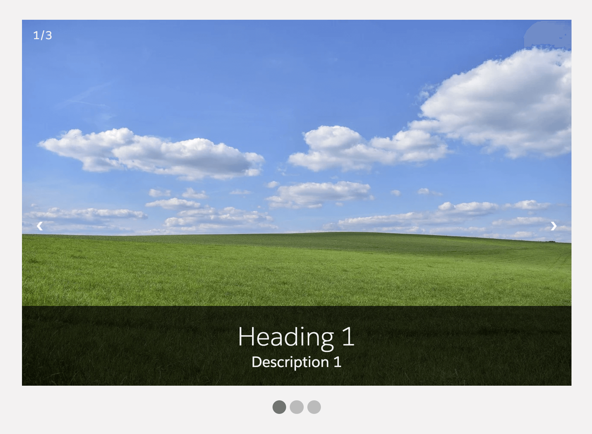

# Custom Carousel

A simple custom carousel with different configuration options.

**Type:** Component

**Available in:** App Page · Home Page · Record Page



## Attributes

| Name                    | Type    | Default         | Description                                                                                                                                                                                                                                                    |
| ----------------------- | ------- | --------------- | -------------------------------------------------------------------------------------------------------------------------------------------------------------------------------------------------------------------------------------------------------------- |
| aspect-ratio            | string  | ''              | Set a fixed aspect ratio for the slides, e.g. '16:9' or '4/3'. The images then fill the slides and are cropped where needed. Takes precedence over custom-height.                                                                                              |
| auto-scroll             | boolean | false           | If present, automatic slide scrolling will be enabled.                                                                                                                                                                                                         |
| card-icon               | string  | 'utility:image' | If show card option is active, the card icon is displayed in the header before the card title. It should contain the SLDS name of the icon. Specify the name in the format 'utility:down' where 'utility' is the category and 'down' the icon to be displayed. |
| card-title              | string  | ''              | If show card option is active, the card title can include text and is displayed in the header above the carousel.                                                                                                                                              |
| custom-height           | string  | ''              | Set maximum height of the carousel in percent or pixels.                                                                                                                                                                                                       |
| custom-width            | string  | '600px'         | Set maximum width of the carousel in percent or pixels.                                                                                                                                                                                                        |
| hide-navigation-buttons | boolean | false           | If present, the "next" and "prev" navigation buttons will be hidden.                                                                                                                                                                                           |
| hide-navigation-dots    | boolean | false           | If present, the navigation dots below the carousel will be hidden.                                                                                                                                                                                             |
| hide-slide-number       | boolean | false           | If present, the current slide number will be hidden.                                                                                                                                                                                                           |
| hide-slide-text         | boolean | false           | If present, the text overlay with heading and description will be hidden.                                                                                                                                                                                      |
| scroll-duration         | number  | 5000            | Set the duration in milliseconds after which the next slide should be displayed.                                                                                                                                                                               |
| show-card               | boolean | false           | If present, the carousel is wrapped in a lightning card to fit better into the overall page layout.                                                                                                                                                            |
| slides-data             | Array   |                 | JSON array of slides that are displayed in the custom carousel. Each slide has the following attributes: image, heading and description.                                                                                                                       |
| transition              | string  | 'fade'          | Set how the carousel moves to another slide: 'fade' blends the new slide in, 'slide' moves it in from the side. Both are switched off when the user prefers reduced motion.                                                                                    |

### Example slides-data JSON array;

```
[
  {
    "image": "https://example.com/image1.jpg",
    "heading": "Slide 1",
    "description": "Description for slide 1"
  },
  {
    "image": "https://example.com/image2.jpg",
    "heading": "Slide 2",
    "description": "Description for slide 2"
  },
  {
    "image": "https://example.com/image3.jpg",
    "heading": "Slide 3",
    "description": "Description for slide 3"
  }
]
```

## Usage

```html
<c-custom-carousel slides-data={slides} custom-width="800px" auto-scroll scroll-duration="7000"></c-custom-carousel>
```

With a fixed aspect ratio, all slides have the same size, whatever the size of their images, and the carousel can sit in a Lightning Card:

```html
<c-custom-carousel slides-data={slides} aspect-ratio="16:9" show-card card-title="Highlights"></c-custom-carousel>
```

When adding the component to a page in the Lightning App Builder, paste a slides JSON array like the example above into the slides-data property.

If the slides-data value is a string that is not valid JSON, the component shows an error message instead of the slides. Without slides, the navigation is hidden.

Changes to auto-scroll and scroll-duration take effect immediately, and new slides-data starts again at the first slide.

## Keyboard, touch and screen readers

- The left and right arrow keys switch slides while the focus is inside the carousel. On a dot, the focus moves along with the slide.
- On touch screens, swipe left or right to switch slides. The mouse can drag in the same way.
- With auto-scroll, a play/pause button next to the dots stops and starts the slide show. The slide show pauses while the mouse is over the carousel, and it stops when the keyboard focus moves into it, until the user starts it again.
- Screen readers announce the carousel as a carousel and each slide with its position, e.g. "2 of 3". When the user switches slides, the new slide is announced; automatic changes are not.

## Component Dependencies

| Name       | Type | Description                                         |
| ---------- | ---- | --------------------------------------------------- |
| errorAlert | LWC  | Inline alert that shows error messages to the user. |
