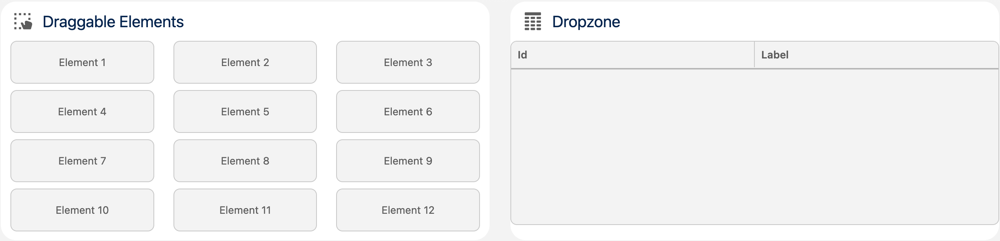

# Drag & Drop

A drag and drop building block based on the HTML Drag and Drop API.

**Type:** Building Block

**Available in:** App Page · Home Page · Record Page



## Read on Medium

<a href="https://medium.com/javascript-in-plain-english/implement-drag-drop-with-lwc-2bb9ef7253d6">
  
</a>

**[Implement Drag & Drop with LWC](https://medium.com/javascript-in-plain-english/implement-drag-drop-with-lwc-2bb9ef7253d6)**

## Attributes

| Name  | Type            | Default | Description                                                                                                                              |
| ----- | --------------- | ------- | ---------------------------------------------------------------------------------------------------------------------------------------- |
| items | Array or string |         | The items to drag, as an array or a JSON string. Each item has a unique id and a label. Twelve demo elements are used until this is set. |

## Events

| Name     | Detail                     | Description                     |
| -------- | -------------------------- | ------------------------------- |
| itemdrop | A copy of the dropped item | Fired when an item was dropped. |

## Usage

```html
<c-drag-and-drop items={items} onitemdrop={handleItemDrop}></c-drag-and-drop>
```

Drag an item into the dropzone and it moves to the datatable there. New items start over with an empty dropzone. If a string is not valid JSON, the component shows an error message.

## Custom Labels

The texts users see are Custom Labels, so they can be translated in Setup with the Translation Workbench. Copy them together with the component.

| Name                          | Value                                                             |
| ----------------------------- | ----------------------------------------------------------------- |
| DragAndDrop_Drag              | Drag                                                              |
| DragAndDrop_DraggableElements | Draggable Elements                                                |
| DragAndDrop_Drop              | Drop                                                              |
| DragAndDrop_Dropzone          | Dropzone                                                          |
| DragAndDrop_Element           | Element {0}                                                       |
| DragAndDrop_Id                | Id                                                                |
| DragAndDrop_InvalidItems      | The items could not be displayed because they are not valid JSON. |
| DragAndDrop_Label             | Label                                                             |
| ErrorAlert_Error              | Error                                                             |

## Component Dependencies

| Name       | Type | Description                                                |
| ---------- | ---- | ---------------------------------------------------------- |
| errorAlert | LWC  | Inline alert that shows error messages to the user.        |
| labelUtils | LWC  | Shared function to fill the placeholders of Custom Labels. |
