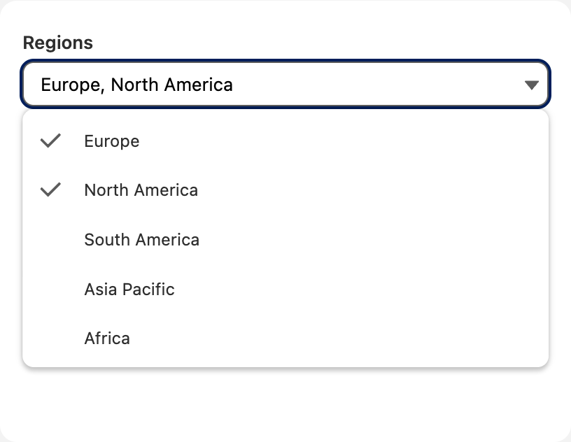

# Multi Select Combobox

Combobox with different configuration options that also supports multi select.

**Type:** Building Block

**Available in:** App Page · Home Page · Record Page · Flow Screen



## Read on Medium

<a href="https://javascript.plainenglish.io/how-to-create-the-lwc-multi-select-combobox-that-salesforce-is-still-missing-c7bf3a2850dd">
  
</a>

**[How to Create the LWC Multi-Select Combobox that Salesforce is Still Missing](https://javascript.plainenglish.io/how-to-create-the-lwc-multi-select-combobox-that-salesforce-is-still-missing-c7bf3a2850dd)**

## Attributes

| Name          | Type            | Default            | Description                                                                                                                                     |
| ------------- | --------------- | ------------------ | ----------------------------------------------------------------------------------------------------------------------------------------------- |
| disabled      | boolean         | false              | If present, the combobox is disabled and users cannot interact with it.                                                                         |
| enable-search | boolean         | false              | If present, a search input is shown inside the dropdown to filter options by label.                                                             |
| label         | string          | ''                 | Text label for the combobox.                                                                                                                    |
| name          | string          |                    | Specifies the name of the combobox.                                                                                                             |
| options       | Array or string | []                 | A list of options that are available for selection, as an array or a JSON string. Each option has a label and a value, and optionally selected. |
| placeholder   | string          | 'Select an Option' | Text that is displayed before an option is selected, to prompt the user to select an option.                                                    |
| read-only     | boolean         | false              | If present, the combobox is read-only. A read-only combobox is also disabled.                                                                   |
| required      | boolean         | false              | If present, a value must be selected before a form can be submitted.                                                                            |
| single-select | boolean         | false              | If present, the combobox only allows the selection of a single value.                                                                           |
| show-pills    | boolean         | false              | If present, the combobox will show a pill container with the currently selected options.                                                        |
| value         | string          |                    | Read-only. The values of the selected options, separated by semicolons. Also available as a Flow output.                                        |
| validate      | method          |                    | Checks the required attribute for Flow screens. Returns isValid and errorMessage.                                                               |

## Usage

```html
<c-multi-select-combobox
  label="Products"
  name="products"
  options={options}
  onchange={handleChange}
  show-pills
  enable-search
></c-multi-select-combobox>
```

Each option requires a `label` and a `value`. If a string is not valid JSON, the component shows an error message.

## Keyboard

| Key                         | Action                                                                     |
| --------------------------- | -------------------------------------------------------------------------- |
| Down, Enter or Space        | Opens the list and moves to the selected or first option.                  |
| Up, Down                    | Moves through the options and wraps around. Up also returns to the search. |
| Home, End                   | Moves to the first or last option.                                         |
| Enter or Space on an option | Selects or deselects it.                                                   |
| Escape                      | Closes the list and returns to the combobox.                               |
| Tab                         | Moves on and closes the list.                                              |

## Events

| Name   | Detail                                                                                 | Description                        |
| ------ | -------------------------------------------------------------------------------------- | ---------------------------------- |
| change | The selected options as an array, or a single option object if `single-select` is set. | Fired when the selection changes.  |
| close  | -                                                                                      | Fired when the dropdown is closed. |

## Custom Labels

The texts users see are Custom Labels, so they can be translated in Setup with the Translation Workbench. Copy them together with the component.

| Name                                  | Value                                                               |
| ------------------------------------- | ------------------------------------------------------------------- |
| ErrorAlert_Error                      | Error                                                               |
| MultiSelectCombobox_ClickHere         | Click here                                                          |
| MultiSelectCombobox_InvalidOptions    | The options could not be displayed because they are not valid JSON. |
| MultiSelectCombobox_OpenDropdown      | Click to open the dropdown                                          |
| MultiSelectCombobox_OptionsSelected   | {0} Options Selected                                                |
| MultiSelectCombobox_Required          | required                                                            |
| MultiSelectCombobox_Search            | Search                                                              |
| MultiSelectCombobox_SearchPlaceholder | Search...                                                           |
| MultiSelectCombobox_SelectValue       | Please select a value.                                              |
| MultiSelectCombobox_SelectValueFor    | Please select a value for {0}.                                      |
| MultiSelectComboboxItem_Selected      | Selected                                                            |

## Component Dependencies

| Name                    | Type | Description                                                                              |
| ----------------------- | ---- | ---------------------------------------------------------------------------------------- |
| labelUtils              | LWC  | Shared function to fill the placeholders of Custom Labels.                               |
| multiSelectComboboxItem | LWC  | Child component that represents an item within the multiSelectCombobox parent component. |
| errorAlert              | LWC  | Inline alert that shows error messages to the user.                                      |
