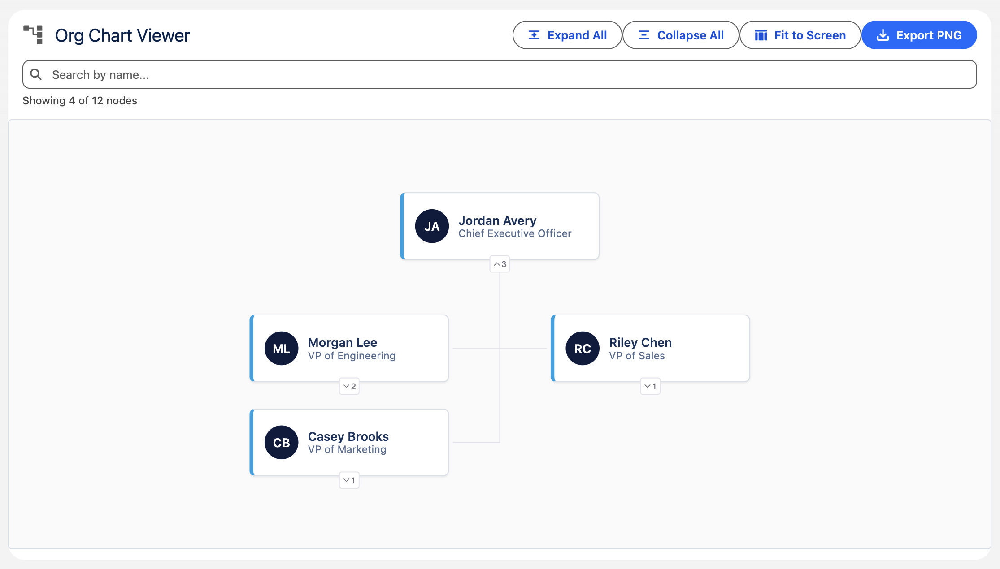

# Org Chart Viewer

An interactive organization chart with search, expand/collapse and PNG export, powered by the [d3-org-chart](https://github.com/bumbeishvili/org-chart) library. It loads the records of any object with a parent field itself, e.g. users and their managers, takes your own hierarchy via the `records` attribute, or shows a small demo dataset.

**Type:** Component

**Available in:** App Page · Home Page · Record Page



## Attributes

| Name                  | Type   | Default | Description                                                                                                                                                            |
| --------------------- | ------ | ------- | ---------------------------------------------------------------------------------------------------------------------------------------------------------------------- |
| image-field           | string |         | API name of the field with an image URL shown instead of the initials, e.g. 'SmallPhotoUrl'.                                                                           |
| name-field            | string | 'Name'  | API name of the field shown as the name of a node.                                                                                                                     |
| chart-object-api-name | string |         | API name of the object whose records the chart loads, e.g. 'User' or 'Contact'. Used together with parent-field-api-name; records set from outside take precedence.    |
| parent-field-api-name | string |         | API name of the field with the parent record, e.g. 'ManagerId', 'ReportsToId' or 'ParentId'.                                                                           |
| record-id             | string |         | Id of the record of the record page, filled automatically there.                                                                                                       |
| records               | Array  | []      | Flat list of records to render as a tree. Each record needs an id (or Id) and a parentId (or ManagerId), plus a name and title.                                        |
| root-record-id        | string |         | Id of the record the chart starts from. Without it, the chart starts from the record of the record page, if it is among the loaded records, or else shows all of them. |
| title-field           | string |         | API name of the field shown below the name, e.g. 'Title'.                                                                                                              |

## Usage

Show the users of the org with their managers, photos and titles:

```html
<c-org-chart-viewer
  chart-object-api-name="User"
  parent-field-api-name="ManagerId"
  title-field="Title"
  image-field="SmallPhotoUrl"
></c-org-chart-viewer>
```

In the Lightning App Builder, set the same values in the properties of the component, e.g. Contact with ReportsToId or Account with ParentId. On a record page of that object, the chart starts from the record of the page; Root Record Id sets another starting point.

Or pass your own hierarchy:

```html
<c-org-chart-viewer records={employees} onnodeselect={handleNodeSelect}></c-org-chart-viewer>
```

### Loading records

- The records are loaded with GraphQL, so no Apex is involved and users only see records and fields they have access to. Invalid object or field names are ignored instead of being sent.
- The chart needs one root. Records whose parent isn't loaded are roots; several roots get a shared top node named after the object, e.g. "Users". Records that can't be reached from a root, like those in a cycle, are left out.
- At most 2000 records are loaded; if there are more, the chart says so. Set a Root Record Id to show a part of a larger hierarchy.
- While the records load, a spinner shows; without records the chart says so, and errors are shown above it.
- A click on a loaded record, or Enter when it has the keyboard focus, opens its record page; the shared top node, the demo data and records set from outside don't navigate.
- Images are shown only from `https://` or relative URLs. The PNG export shows the initials instead, because Salesforce doesn't allow reading images from its file domain for the export.

## Events

| Name       | Detail                                        | Description                                                                                                                                                               |
| ---------- | --------------------------------------------- | ------------------------------------------------------------------------------------------------------------------------------------------------------------------------- |
| nodeselect | `{ record }` - the record of the clicked node | Fired whenever a node in the chart is clicked, so a parent component can react to the selection. It is cancelable: `preventDefault()` keeps a loaded record from opening. |

## Component Dependencies

| Name       | Type            | Description                                                                                   |
| ---------- | --------------- | --------------------------------------------------------------------------------------------- |
| d3orgchart | Static Resource | d3 v7 + d3-flextree + d3-org-chart - Libraries for rendering interactive organization charts. |
| errorAlert | LWC             | Inline alert that shows error messages to the user.                                           |
| errorUtils | LWC             | Shared functions to read error messages and show error toasts.                                |
