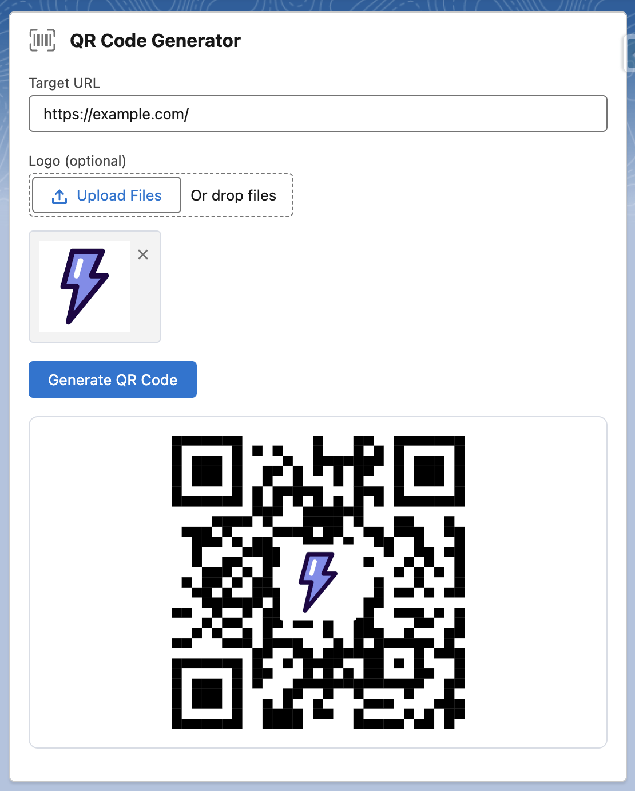

# QR Code Generator

A basic QR Code Generator with optional logo overlay using the external QRCode.js library.

**Type:** Component

**Available in:** App Page · Home Page · Record Page · Flow Screen



## Read on Medium

<a href="https://medium.com/capgemini-salesforce-architects/how-to-generate-qr-codes-with-lightning-web-components-4d41dd09f3c1">
  
</a>

**[How to Generate QR Codes with Lightning Web Components](https://medium.com/capgemini-salesforce-architects/how-to-generate-qr-codes-with-lightning-web-components-4d41dd09f3c1)**

## Attributes

| Name                | Type    | Default   | Description                                                                                                     |
| ------------------- | ------- | --------- | --------------------------------------------------------------------------------------------------------------- |
| color-dark          | string  | '#000000' | The color of the dark modules of the code. Keep enough contrast to the light color, so that it stays scannable. |
| color-light         | string  | '#ffffff' | The color of the light modules of the code.                                                                     |
| field-api-name      | string  |           | The field to read the text from, as 'Website' on record pages or as 'Account.Website' everywhere else.          |
| hide-input          | boolean | false     | If present, only the code is shown, without the inputs and the generate button.                                 |
| logo-url            | string  |           | The logo to show in the code. An image from another domain needs to allow this with CORS.                       |
| object-api-name     | string  |           | The API name of the object of the record. Set automatically on record pages.                                    |
| record-id           | string  |           | The record to read the field from and to save the code to. Set automatically on record pages.                   |
| save-to-record      | boolean | false     | If present, a button saves the code as a file on the record given by record-id.                                 |
| size                | number  | 256       | The displayed size of the code in pixels. The image has at least a resolution of 1024 pixels.                   |
| value               | string  |           | The text of the code. It wins over a record field, and the code is generated without a click.                   |
| qr-code-data-url    | string  |           | Read-only. The code as a PNG data URL, empty without a code. Also available as a Flow output.                   |
| content-document-id | string  |           | Read-only. The id of the saved file. Empties with a new code. Also available as a Flow output.                  |

## Events

| Name           | Detail                  | Description                                             |
| -------------- | ----------------------- | ------------------------------------------------------- |
| qrcodegenerate | `{ dataUrl, value }`    | Fired when a code was generated.                        |
| qrcodesave     | `{ contentDocumentId }` | Fired after the code was saved as a file on the record. |

## Usage

```html
<c-qr-code-generator value="https://example.com" hide-input onqrcodegenerate={handleGenerate}></c-qr-code-generator>
```

Without attributes, users enter a text or URL, optionally upload a logo and generate the code. With `value` or a record field, the code is generated without a click.

Saving creates the file directly through Lightning Data Service, so no Apex is involved and the permissions of the user apply.

## Component Dependencies

| Name       | Type            | Description                                                              |
| ---------- | --------------- | ------------------------------------------------------------------------ |
| qrcodejs   | Static Resource | QRCode.js - JavaScript Library for generating QRCodes with Logo Support. |
| errorAlert | LWC             | Inline alert that shows error messages to the user.                      |
| errorUtils | LWC             | Shared functions to read error messages and show error toasts.           |
