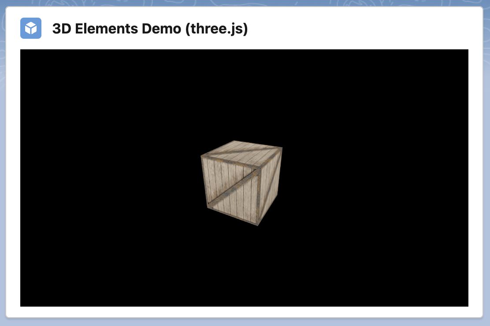

# Render 3D Elements

A 3D viewer for glTF and GLB models using Three.js. Without a model, it shows a rotating crate.

**Type:** Component

**Available in:** App Page · Home Page · Record Page · Flow Screen



## Read on Medium

<a href="https://medium.com/capgemini-salesforce-architects/how-to-render-3d-elements-with-lightning-web-components-7f603129d5f0">
  
</a>

**[How to Render 3D Elements with Lightning Web Components](https://medium.com/capgemini-salesforce-architects/how-to-render-3d-elements-with-lightning-web-components-7f603129d5f0)**

## Attributes

| Name             | Type    | Default           | Description                                                                                                                                                                                                                                                    |
| ---------------- | ------- | ----------------- | -------------------------------------------------------------------------------------------------------------------------------------------------------------------------------------------------------------------------------------------------------------- |
| background-color | string  | ''                | Background color of the scene as a CSS color, e.g. '#f3f3f3' or 'white'. Without it, the background is black.                                                                                                                                                  |
| card-icon        | string  | 'custom:custom57' | If show card option is active, the card icon is displayed in the header before the card title. It should contain the SLDS name of the icon. Specify the name in the format 'utility:down' where 'utility' is the category and 'down' the icon to be displayed. |
| card-title       | string  | '3D Viewer'       | If show card option is active, the card title can include text and is displayed in the header above the viewer.                                                                                                                                                |
| disable-rotation | boolean | false             | If present, the model doesn't rotate on its own.                                                                                                                                                                                                               |
| enable-controls  | boolean | false             | If present, the model can be rotated with the mouse or touch, zoomed with the wheel and moved with the right mouse button.                                                                                                                                     |
| height           | string  | '400px'           | Height of the viewer, e.g. '400px'. The width follows the container.                                                                                                                                                                                           |
| model-url        | string  | ''                | URL of a glTF or GLB model, e.g. of a static resource: '/resource/carModel'. Without it, the viewer shows a crate.                                                                                                                                             |
| show-card        | boolean | false             | If present, the viewer is wrapped in a lightning card to fit better into the overall page layout.                                                                                                                                                              |

## Usage

```html
<c-render3-d-elements-three-j-s
  model-url="/resource/carModel"
  enable-controls
  background-color="#f3f3f3"
  height="500px"
  show-card
></c-render3-d-elements-three-j-s>
```

Upload the model as a static resource and set its URL, `/resource/<name>`, in the Model URL property of the Lightning App Builder. The viewer centers the model, lights it and moves the camera so that the whole model is visible. With enable-controls, the mouse pointer turns into a hand over the model. If Three.js or the model cannot be loaded, or the browser has no WebGL, it shows an error message.

- Use a GLB file, or a glTF file with its `.bin` and textures zipped into one static resource, e.g. `/resource/carModel/scene.gltf`. A glTF with its data embedded as `data:` URIs doesn't load, because the Content Security Policy of Lightning blocks them.
- Files attached to a record can't be shown: Salesforce serves them from its file domain, which the browser doesn't allow the viewer to read.

### Building Three.js

The `threejs` static resource is Three.js 0.186.1 bundled with `GLTFLoader` and `OrbitControls` into one script that sets the global `THREE`. To update it, install `three` and `esbuild` outside the project and bundle this entry file:

```js
import * as three from 'three';
import { GLTFLoader } from 'three/examples/jsm/loaders/GLTFLoader.js';
import { OrbitControls } from 'three/examples/jsm/controls/OrbitControls.js';

globalThis.THREE = { ...three, GLTFLoader, OrbitControls };
```

```bash
npx esbuild entry.js --bundle --minify --format=iife --target=es2020 --legal-comments=none --outfile=threejs.js
```

## Component Dependencies

| Name          | Type            | Description                                                                                             |
| ------------- | --------------- | ------------------------------------------------------------------------------------------------------- |
| threejs       | Static Resource | Three.js 0.186.1 with GLTFLoader and OrbitControls - Lightweight, cross-browser 3D library using WebGL. |
| crateMaterial | Static Resource | Texture of the crate shown without a model.                                                             |
| errorAlert    | LWC             | Inline alert that shows error messages to the user.                                                     |
| errorUtils    | LWC             | Shared functions to read error messages and show error toasts.                                          |
