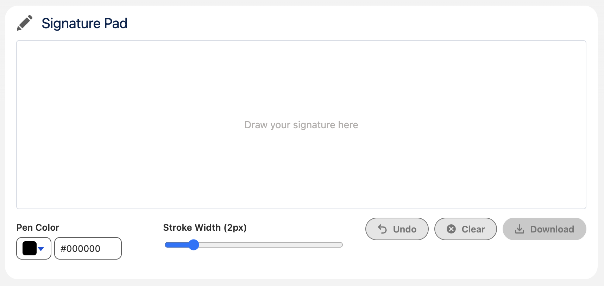

# Signature Pad

A canvas-based signature capture component with mouse and touch support. Works on desktop and mobile devices without any external libraries.

**Type:** Component

**Available in:** App Page · Home Page · Record Page · Flow Screen



## Attributes

| Name                | Type    | Default   | Description                                                                                                |
| ------------------- | ------- | --------- | ---------------------------------------------------------------------------------------------------------- |
| pen-color           | string  | '#000000' | The initial pen color.                                                                                     |
| stroke-width        | number  | 2         | The initial stroke width in pixels.                                                                        |
| height              | string  | ''        | The height of the signature area, for example '400px'. By default it depends on the screen size.           |
| required            | boolean | false     | If present, a signature is required by the validate method.                                                |
| record-id           | string  |           | The record to save the signature to. Set automatically on record pages.                                    |
| save-to-record      | boolean | false     | If present, a button saves the signature as a file on the record given by record-id.                       |
| signature-data-url  | string  |           | Read-only. The signature as a PNG data URL, empty while the pad is empty. Also available as a Flow output. |
| content-document-id | string  |           | Read-only. The id of the saved file. Empties when the signature changes. Also available as a Flow output.  |
| validate            | method  |           | Checks the required attribute for Flow screens. Returns isValid and errorMessage.                          |

## Usage

```html
<c-signature-pad record-id={recordId} save-to-record onsignaturesave={handleSignatureSave}></c-signature-pad>
```

Saving creates the file directly through Lightning Data Service, so no Apex is involved and the permissions of the user apply. Users need access to the record and permission to create files.

## Events

| Name            | Detail                  | Description                                                                                                                                           |
| --------------- | ----------------------- | ----------------------------------------------------------------------------------------------------------------------------------------------------- |
| signaturechange | `{ dataUrl, isEmpty }`  | Fired after every stroke and when the pad is cleared. dataUrl contains the signature as a PNG data URL and is an empty string while the pad is empty. |
| signaturesave   | `{ contentDocumentId }` | Fired after the signature was saved as a file on the record.                                                                                          |

## Custom Labels

The texts users see are Custom Labels, so they can be translated in Setup with the Translation Workbench. Copy them together with the component.

| Name                          | Value                         |
| ----------------------------- | ----------------------------- |
| ErrorUtils_UnknownError       | Unknown error                 |
| SignaturePad_Clear            | Clear                         |
| SignaturePad_Download         | Download                      |
| SignaturePad_ErrorSaving      | Error saving the signature    |
| SignaturePad_FileTitle        | Signature                     |
| SignaturePad_PenColor         | Pen Color                     |
| SignaturePad_Placeholder      | Draw your signature here      |
| SignaturePad_ProvideSignature | Please provide a signature.   |
| SignaturePad_Save             | Save                          |
| SignaturePad_Saved            | The signature has been saved. |
| SignaturePad_SaveSignature    | Please save your signature.   |
| SignaturePad_Saving           | Saving                        |
| SignaturePad_StrokeWidth      | Stroke Width ({0}px)          |
| SignaturePad_Success          | Success                       |
| SignaturePad_Title            | Signature Pad                 |
| SignaturePad_Undo             | Undo                          |

## Component Dependencies

| Name       | Type | Description                                                    |
| ---------- | ---- | -------------------------------------------------------------- |
| errorUtils | LWC  | Shared functions to read error messages and show error toasts. |
| labelUtils | LWC  | Shared function to fill the placeholders of Custom Labels.     |
