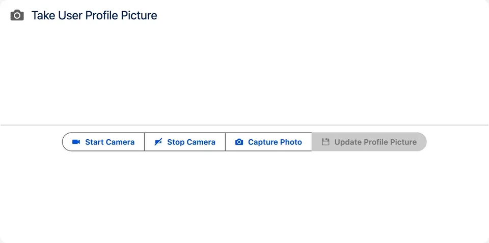

# Take User Profile Picture

A simple component that makes use of the Media Capture and Streams API to allow Salesforce users to take a new photo with their device's camera and use it to update their personal user profile.

**Type:** Component

**Available in:** App Page · Home Page · Record Page · Flow Screen



## Read on Medium

<a href="https://medium.com/gitconnected/allow-your-salesforce-users-to-take-a-new-profile-picture-201b45de9a6c">
  
</a>

**[Allow your Salesforce Users to take a new Profile Picture](https://medium.com/gitconnected/allow-your-salesforce-users-to-take-a-new-profile-picture-201b45de9a6c)**

## Attributes

| Name           | Type   | Default | Description                                                                         |
| -------------- | ------ | ------- | ----------------------------------------------------------------------------------- |
| default-camera | string | 'front' | The camera to start with, front or back. Devices with only one camera use that one. |

## Usage

```html
<c-take-user-profile-picture default-camera="front"></c-take-user-profile-picture>
```

The component is self-contained: it asks for camera access, takes a photo and updates the profile picture of the current user. To use the camera for something else, see Camera Capture.

## Custom Labels

The texts users see are Custom Labels, so they can be translated in Setup with the Translation Workbench. Copy them together with the component.

| Name                                     | Value                                                                            |
| ---------------------------------------- | -------------------------------------------------------------------------------- |
| CameraCapture_CapturePhoto               | Capture Photo                                                                    |
| CameraCapture_Error                      | Error                                                                            |
| CameraCapture_ErrorAccessingCamera       | Error accessing camera                                                           |
| CameraCapture_NotSupported               | getUserMedia is not supported in this browser                                    |
| CameraCapture_StartCamera                | Start Camera                                                                     |
| CameraCapture_StopCamera                 | Stop Camera                                                                      |
| ErrorUtils_UnknownError                  | Unknown error                                                                    |
| TakeUserProfilePicture_CapturePhoto      | Capture Photo                                                                    |
| TakeUserProfilePicture_ErrorSaving       | Error saving the profile picture                                                 |
| TakeUserProfilePicture_NewProfilePreview | Preview of the new profile                                                       |
| TakeUserProfilePicture_StartCamera       | Start Camera                                                                     |
| TakeUserProfilePicture_StopCamera        | Stop Camera                                                                      |
| TakeUserProfilePicture_Success           | Success                                                                          |
| TakeUserProfilePicture_Title             | Take User Profile Picture                                                        |
| TakeUserProfilePicture_Updated           | Profile picture has been updated, it takes some time until the change is visible |
| TakeUserProfilePicture_UpdateProfile     | Update Profile Picture                                                           |

## Component Dependencies

| Name                             | Type | Description                                                    |
| -------------------------------- | ---- | -------------------------------------------------------------- |
| UserProfilePictureController     | Apex | Controller class for updating the user's profile picture.      |
| UserProfilePictureControllerTest | Apex | Test class for UserProfilePictureController.                   |
| errorUtils                       | LWC  | Shared functions to read error messages and show error toasts. |
| cameraCapture                    | LWC  | Building block for the live camera view and taking photos.     |
