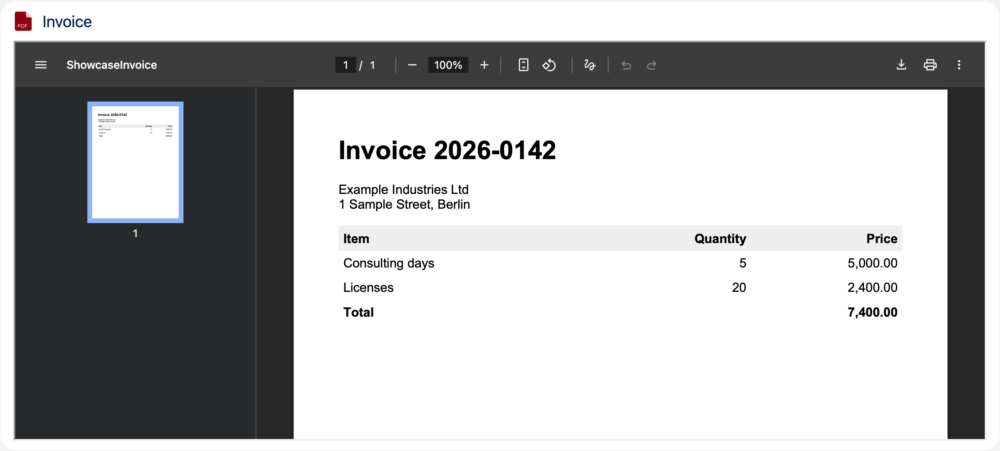

# Visualforce To PDF

A simple utility for displaying Visualforce based PDF documents.

**Type:** Utility

**Available in:** App Page · Home Page · Record Page · Flow Screen



## Attributes

| Name       | Type    | Default       | Description                                                                                                                                                                                                                                                    |
| ---------- | ------- | ------------- | -------------------------------------------------------------------------------------------------------------------------------------------------------------------------------------------------------------------------------------------------------------- |
| card-icon  | string  | 'doctype:pdf' | If show card option is active, the card icon is displayed in the header before the card title. It should contain the SLDS name of the icon. Specify the name in the format 'utility:down' where 'utility' is the category and 'down' the icon to be displayed. |
| card-title | string  | ''            | If show card option is active, the card title can include text and is displayed in the header above the PDF viewer.                                                                                                                                            |
| height     | string  | '500px'       | Specifies the height of the PFD viewer. Default height is 500 pixels.                                                                                                                                                                                          |
| show-card  | boolean | false         | If present, the PDF viewer is wrapped in a lightning card to fit better into the overall page layout.                                                                                                                                                          |
| url        | string  | ''            | Specifies the Visualforce Page address of the document to be displayed.                                                                                                                                                                                        |
| width      | string  | '100%'        | Specifies the width of the PFD viewer. Default width is 100 percent.                                                                                                                                                                                           |

## Usage

```html
<c-visualforce-to-pdf url="/apex/AccountDetails" height="800px"></c-visualforce-to-pdf>
```

Wrap it in a Lightning Card to match the cards around it on a page:

```html
<c-visualforce-to-pdf url="/apex/AccountDetails" show-card card-title="Account Details"></c-visualforce-to-pdf>
```

The url attribute takes the relative address of a Visualforce page that is rendered as PDF (`renderAs="pdf"`).

## Custom Labels

The texts users see are Custom Labels, so they can be translated in Setup with the Translation Workbench. Copy them together with the component.

| Name                        | Value              |
| --------------------------- | ------------------ |
| VisualforceToPdf_FrameTitle | Visualforce to PDF |
